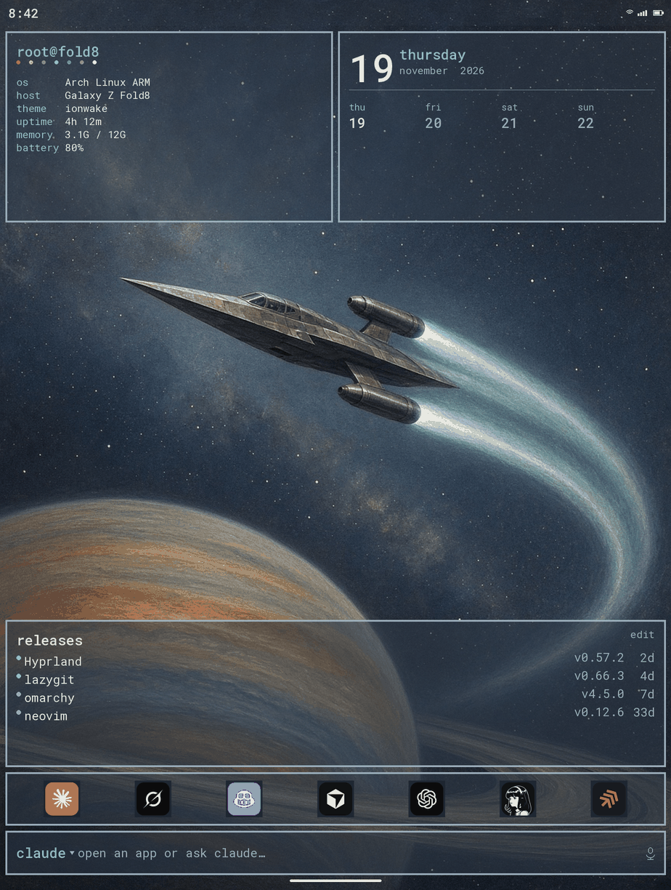

# ionwake

a slender interceptor cutting a pale ion trail past a ringed giant: dusk-blue slate, cream type, cyan accent



## Palette

| Key | Value |
|-----|-------|
| `mode` | `dark` |
| `accent` | `#6ec9d4` |
| `selection` | `#3a4e5c` |
| `muted` | `#9aabba` |
| `background` | `#2e3a48` |
| `dark_background` | `#252f3b` |
| `darker_background` | `#1c2430` |
| `lighter_background` | `#3a4858` |
| `foreground` | `#e8e6dc` |
| `dark_foreground` | `#9aabba` |
| `light_foreground` | `#f0eee6` |
| `bright_foreground` | `#f7f5ee` |

Full `colors.toml`:

```toml
mode = "dark"

accent = "#6ec9d4"
selection = "#3a4e5c"
muted = "#9aabba"

background = "#2e3a48"
dark_background = "#252f3b"
darker_background = "#1c2430"
lighter_background = "#3a4858"

foreground = "#e8e6dc"
dark_foreground = "#9aabba"
light_foreground = "#f0eee6"
bright_foreground = "#f7f5ee"

red = "#c45a52"
yellow = "#e0c878"
orange = "#d48858"
green = "#7aaa74"
cyan = "#6ec9d4"
blue = "#6a8cb0"
magenta = "#a878a0"
brown = "#8a7060"

bright_red = "#e07870"
bright_yellow = "#eed89a"
bright_green = "#96c490"
bright_cyan = "#8edce4"
bright_blue = "#88a8c8"
bright_magenta = "#c094b8"
```

## Install

Paste this URL into Omalauncher's theme install:

https://github.com/TheFifeDawg/omarchy-ionwake-theme

On an Omarchy laptop: **Install > Style > Theme**, paste the same URL.

## Wallpapers

The three wallpapers are AI-generated original space-opera scenes:

- `1-streak.jpg` — a slender interceptor cutting a pale ion trail past a ringed giant
- `2-jump.jpg` — the same ship in a dusk-blue star-streak jump
- `3-formation.jpg` — a four-ship formation over the giant's limb and a small moon

They're sized 1848×2448 for the Samsung Galaxy Z Fold 8 inner screen and framed to center-crop cleanly to the cover screen (1248×1972).

## Extras

Includes a `btop.theme` built from Omarchy's template, so the palette carries over to btop on a laptop.

## License

MIT. See [LICENSE](LICENSE).
